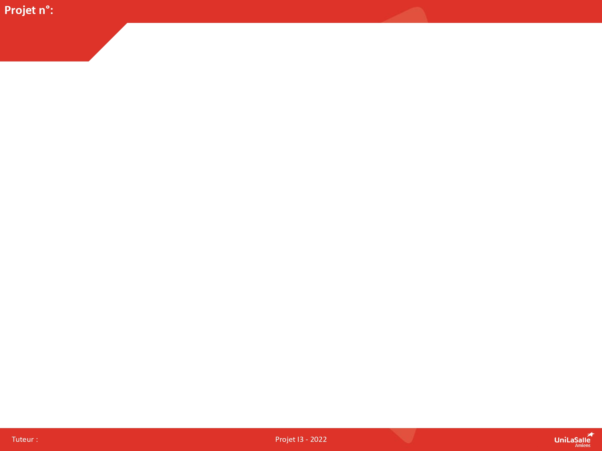

{: .a_supprimer }
> Ce site est le **template de documentation** de votre projet. Tout ce qui est
> marqué « À modifier » est un exemple à remplacer par votre contenu, tout ce qui
> est marqué « À supprimer » est une consigne à retirer avant le rendu final.
>
> Le découpage des pages est un **point de départ** : ajoutez, renommez, divisez
> les pages selon les besoins de votre projet.
>
> Les guides pour prendre en main ce template sont sur le
> [site de documentation du MakerSpace](https://doc.makerspace-amiens.fr/workshops/methodologie-de-projet/).

# Sandraw

{: .a_modifier }
> Remplacez le titre ci-dessus et le texte ci-dessous par une présentation de votre projet.

Décrivez ici en quelques lignes l'objectif de votre projet. Quel est son but ?
À qui est-il destiné ? Quel problème cherche-t-il à résoudre ?

Sandraw est une machine qui dessine toute seule sur du sable. Sous un plateau recouvert d'une fine couche de sable, (un aimant guidé par des moteurs déplace silencieusement une bille en métal pour tracer des motifs géométriques en continu.)

L'idée derrière ce projet est de créer un objet original, qui se démarque des autres projets en ne faisant pas une machine qui dessine sur une simple feuille, écologique en réutilisant le sable autant de fois qu'on voudra, tout en relevant un vrai défi technique mêlant mécanique, électronique et programmation. Chacun peut ainsi choisir ou créer ses propres dessins et regarder la machine les réaliser.

[Notre repo GitHub]({{ site.gh_edit_repository }}){: .btn .btn-primary .fs-5 .mb-4 .mb-md-0 .mr-2 }
[Notre projet sur Onshape](https://cad.onshape.com/){: .btn .fs-5 .mb-4 .mb-md-0 }

{: .a_modifier }
> Remplacez le lien du bouton « Onshape » par le lien de partage de votre document.
> Le bouton « repo GitHub » utilise l'adresse renseignée dans `docs/_config.yml`.

## Le projet en 3D



{: .a_modifier }
> Exportez votre assemblage au format **GLB** (glTF binaire) depuis Onshape
> (clic droit sur l'onglet de l'assemblage > Exporter), placez-le dans `docs/assets/models/`,
> remplacez `Otto.glb` ci-dessus par le nom de votre fichier, puis supprimez `Otto.glb`.
> Gardez le fichier sous **25 Mo**.

## Poster

{: .a_modifier }
> Remplacez `docs/assets/images/poster.jpg` par votre poster (image de moins de **2 Mo**).

## Vidéo

<video src="assets/images/intro_amiens.mp4" controls title="Présentation du projet" style="width: 100%;"></video>

{: .a_modifier }
> Remplacez `docs/assets/images/intro_amiens.mp4` par votre vidéo :
> - 1 min 30 au format vertical ;
> - présentation du projet, fonctionnement, vues du prototype, conclusion ;
> - moins de **25 Mo** (exportez en 720p, par exemple avec HandBrake).
>
> Voir [Créer le poster et la vidéo de présentation](https://doc.makerspace-amiens.fr/workshops/methodologie-de-projet/tutorials/poster-video-presentation/).
