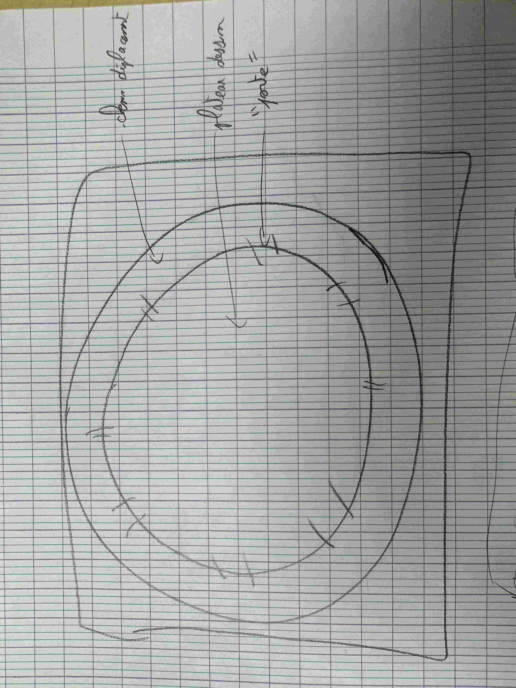
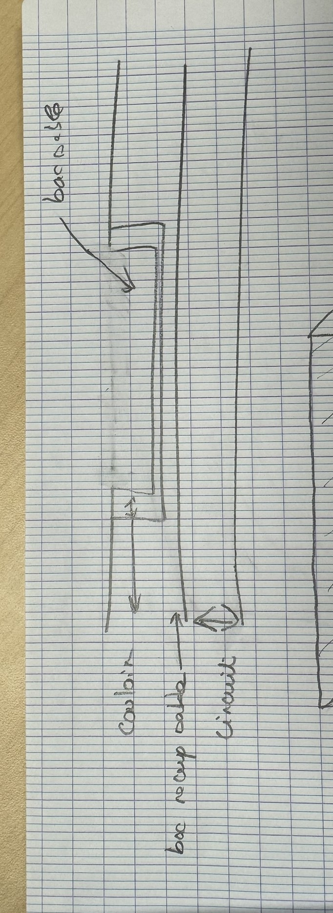
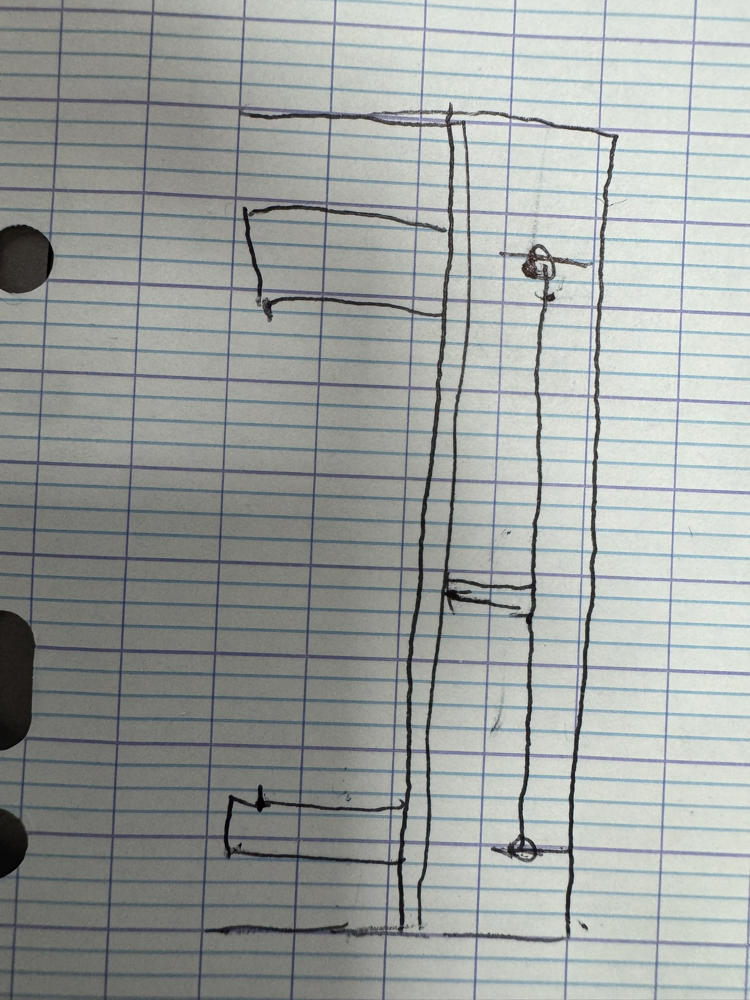

# 2026-11-20 : Choix de l'architecture du plateau

**Séance :** planifiée · **Durée :** 3 h

## Fait

- Réflexion sur l'architecture mécanique du système de dessin.
- Décision de réaliser un **plateau de forme circulaire** pour accueillir le sable et permettre la réalisation des dessins.
- Réflexion sur la création de chemins de passage sur les côtés du plateau afin de permettre à la bille de se déplacer sur toute la surface.
- Étude du principe de circulation de la bille entre les différentes zones du plateau.
- Première réflexion sur l'intégration du système de déplacement tout en conservant une surface de dessin dégagée.

Idée de racleur pour effacer le dessin

Recuperation du sable en dessous -> prevoir percage pour évacuation du sable dans les "chemins de deplacement"

Bouton d'arret d'urgence latéral
LED d'ambiance autour
Haut parleur pour musique et son d'ambiance + annonce

On a choisi une dimension de plateau rond d'environ 17cm

Plaque de 17cm sera sur glissiere pour recupérer le sable qui tombe des chemins de deplacement

Idée du double bas pour soulever la bille 

Bille qui en fin de cycle refait le quadrillage initial pour gommer ses lignes de déplacement

## Pourquoi

- **Architecture mécanique :** adapter la forme du plateau au fonctionnement général de la machine.
- **Déplacement de la bille :** permettre à la bille d'accéder à l'ensemble de la surface de dessin grâce à des chemins de passage latéraux.
- **Optimisation de l'espace :** conserver une surface de dessin circulaire tout en intégrant les éléments nécessaires au déplacement de la bille.
- **Conception :** définir une architecture qui facilitera la réalisation et l'intégration des futurs sous-ensembles.

## Reste à faire

- Définir précisément les dimensions du plateau circulaire.
- Concevoir les chemins de passage latéraux pour la bille.
- Étudier le mécanisme permettant de déplacer la bille dans ces chemins.
- Vérifier que la bille peut atteindre l'ensemble de la surface de dessin.
- Réaliser une première modélisation 3D de l'architecture retenue.
- Vérifier la faisabilité mécanique de cette solution.